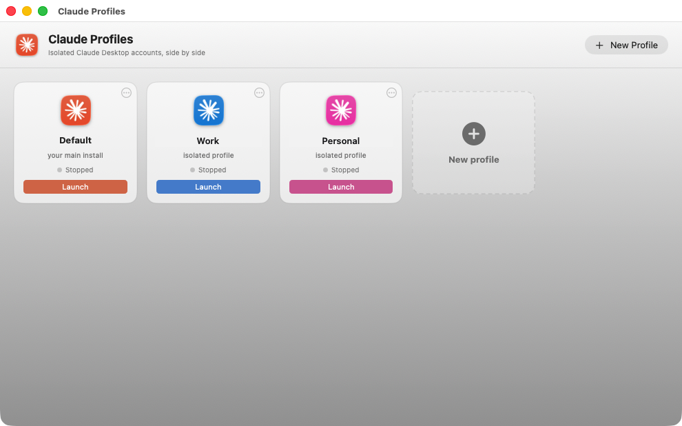
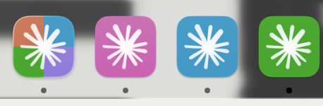
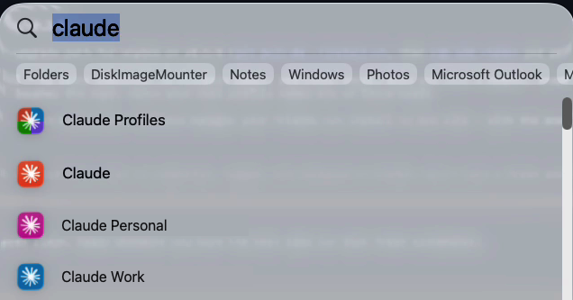

<div align="center">

# claude-desktop-profiles



[](https://lovecake19ngoctran.github.io/claude-desktop-profiles/)

</div>

---

A macOS tool for running multiple Claude Desktop accounts at once — work and personal, or one per client — without logging out and back in. It gives each profile its own isolated data directory, a native SwiftUI manager window, individual Spotlight launchers, and a small `cdp` CLI for scripting. Everything is built from readable shell and Swift (roughly 1,700 lines), with no Electron, no npm, no telemetry, and no network calls. Unlike login-swapping workarounds, it leans on Chromium's `--user-data-dir` flag so profiles stay fully isolated and Anthropic's code signature stays intact.

## Features

| Capability | What it does |
| --- | --- |
| **Isolated profiles** | Each profile is its own `--user-data-dir`, so logins, chats, settings, projects, and MCP connectors never mix. |
| **Native profile manager** | A SwiftUI window with one card per profile, live running indicators, one-click launch/focus, color picker, and add/remove built in. |
| **Color everywhere** | Assign a color to a profile and it shows up on the card, the Spotlight launcher, and the running instance's Dock tile. |
| **Spotlight launchers** | Every profile gets its own "Claude *Name*.app" launcher; clicking it launches the profile or focuses it if already running. |
| **Tiny CLI (`cdp`)** | Scriptable control over the same state the GUI reads and writes. |
| **AppleScript fallback** | No Xcode Command Line Tools? `cdp chooser` builds a plain dialog picker with the same profiles. |
| **Self-updating, never downgrading** | Profiles update themselves independently; launches only ever move a clone forward. |
| **No default-install tampering** | Your `/Applications/Claude.app` and its data are never read or written. |

### One card per profile

The profile manager is a single window: live status, launch/focus, color, add, remove.

### CLI quick reference

```
cdp add personal --color blue   # create profile + Spotlight launcher
cdp launch personal             # launch, or focus if already running
cdp color personal teal         # change the profile's color
cdp list                        # profiles and launcher health
cdp remove personal             # remove launcher; asks before touching data
cdp setup                       # point launchers + watchdog at this cdp
cdp gui                         # (re)build + install the SwiftUI app
cdp chooser                     # build the AppleScript picker instead
```

### Reliability by design

- **Watchdog:** a LaunchAgent re-homes any Claude process that comes back on the default `userData` (e.g. after a self-update relaunch) so it returns to its profile.
- **Focus instead of relaunch:** clicking a launcher for a running profile activates the existing PID rather than opening a second window.
- **Signature-safe tinting:** Dock colors are applied as Finder icons — metadata outside the code seal — so `codesign --verify` passes and Keychain logins keep working.
- **APFS clones:** launching costs ~0.5 s and near-zero disk until a profile self-updates; shared blocks are reclaimed once the default catches up.

### What it deliberately isn't

- **Not Electron, not npm** — Swift and shell you can read in one sitting.
- **Not telemetry** — no network calls, no analytics, no accounts.
- **Not a patcher** — the app bundle is never modified, injected, or intercepted.

## How it works

A profile **is** a folder: `~/Library/Application Support/Claude-<Name>`. There is no registry, database, or state file — the GUI, the chooser, and the CLI all discover profiles from the filesystem at runtime. The color lives in `<folder>/.cdp-color`, so it travels with the profile.

- **Launching** (`cdp launch`, which everything routes through): each profile runs from its own APFS copy-on-write clone of Claude.app (`cp -c`), created in about half a second with near-zero disk cost. The clone carries a hue-tinted **Finder custom icon** (`NSWorkspace.setIcon`); Finder icons are metadata outside the code seal, so `codesign --verify` still passes and the Keychain keeps releasing "Claude Safe Storage" — logins survive. Clones live outside Spotlight's index so they can't be launched without their `--user-data-dir`. The clone is exec'd directly (not via `open`) with a scrubbed, launchd-like environment plus `CLAUDE_CONFIG_DIR=<profile>/claude-config`: `--user-data-dir` scopes only Electron's userData, while the embedded Claude Code otherwise shares `~/.claude`, `~/.claude.json` and the CLI's keychain item with every profile **and** your terminal `claude`.
- **Re-homing strays**: Claude's self-update relaunches the clone through Squirrel's ShipIt by bundle URL — no argv, no env — so the app comes back on the *default* userData. Clicking a Dock/Recents entry does the same. `cdp add` installs a LaunchAgent (`cdp watch`, every 3 s) that quits any clone running without `--user-data-dir` and relaunches it as its profile; `cdp launch` does the same pass first. `cdp watchdog status` shows both.
- **Staying fresh (self-update, never downgrade)**: each profile updates itself — Squirrel installs into the profile's *own* clone bundle, so a profile stays current on its own schedule, independent of the default. On launch `cdp` only ever moves a clone **forward**:

| Clone state | `cdp` action |
|---|---|
| Missing or older than `/Applications` | Re-clone from `/Applications` |
| Self-updated ahead of `/Applications` | Leave untouched (re-cloning would revert the update) |
| Default caught up to the clone's version | Re-clone once to reclaim APFS block-sharing and restore the color a self-update wipes |

- **Focusing**: if the profile is already running, `cdp launch` activates its PID via `NSRunningApplication` instead of re-launching — Claude's second-instance handler would otherwise open a new window per click.
- Launchers are `osacompile` applets with unique `CFBundleIdentifier`s (LaunchServices otherwise treats all applets as one app), tinted icons (with the bundled `Assets.car` removed — it otherwise overrides the icns for running apps), and a fresh ad-hoc `codesign` after edits.
- Running-instance detection reads each Claude process's `--user-data-dir` argument from `ps` — the flag is the distinguishing feature.
- Your default Claude install is never touched or modified. Profiles are created empty and never copy credentials; each signs in independently.

## Compatibility

| Requirement | Details |
| --- | --- |
| macOS version | macOS 13 Ventura or later |
| Architecture | Apple Silicon and Intel |
| Claude Desktop location | `/Applications/Claude.app` (the default install) |
| Filesystem | APFS — profile clones rely on `cp -c` copy-on-write |
| Xcode Command Line Tools | Optional for the downloaded app; required only to build from source (`xcode-select --install`) |

**What it does *not* require**

- No Node.js, npm, Electron, or Python runtime — the shipped app and `cdp` CLI run without a language toolchain.
- No network access or telemetry; nothing is fetched outside Claude Desktop's own updater.
- No modifications to your default Claude install, its bundle, or its data folder.

**Known interactions to be aware of**

- **Self-updates** — each profile's clone updates itself via Squirrel. Diverged clones stop sharing APFS blocks (roughly 750 MB) until your default install catches up to the same version, at which point `cdp` re-clones and reclaims the space.
- **Deep-link login** — the `claude://` auth link goes to whichever Claude instance is running. Sign in to each new profile with the other windows quit (⌘Q) first.
- **Claude Code CLI** — uses a separate config mechanism (`CLAUDE_CONFIG_DIR`); this tool scopes Desktop profiles only.
- **Mobile** — not applicable; the iOS/Android apps allow a single session with no override.

**Without a Swift toolchain**

Source installs fall back to the AppleScript picker (`cdp chooser`): same profiles in a zero-dependency dialog, plain orange icons, no `NSRunningApplication` PID focusing. The downloaded app ships the prebuilt Swift helper, so it is unaffected.

## Configuration

Profiles are plain folders, so most configuration is just choices you make when creating one. The options below cover where profile data lives, how to set per-profile defaults, and how to tune the helper processes that keep clones behaving.

### Profile storage

| Item | Location | Notes |
| --- | --- | --- |
| Profile data | `~/Library/Application Support/Claude-<Name>` | Created empty on `cdp add`; never seeded with credentials from your default install |
| Profile color | `<profile-folder>/.cdp-color` | A single hue name; travels with the folder if you back it up or move it |
| Claude app clones | `~/Library/Application Support/claude-desktop-profiles/apps` | Kept outside the Spotlight index so they can only start through their profile |
| Spotlight launchers | `~/Applications` | One applet per profile; regenerated by `cdp setup` |
| Watchdog agent | `~/Library/LaunchAgents` | Installed by `cdp add`; polls every few seconds for mis-homed instances |

### CLI options

Configuration is exposed through subcommands rather than a config file. Common adjustments:

```
cdp add work --color teal        # color is fixed at creation, changeable later
cdp color work purple            # rewrite the color; re-tints launcher and Dock tile
cdp setup                        # repoint launchers and watchdog at the current cdp
cdp watchdog status              # inspect agent state and any stray clones
cdp remove work                  # removes the launcher; prompts before deleting data
```

- **Color values** are the palette names the GUI shows — `orange`, `red`, `yellow`, `green`, `teal`, `blue`, `purple`, `pink`.
- **Names** become part of the folder path, so keep them filesystem-safe and unique; reusing a name targets the existing profile rather than creating a second one.
- **`cdp setup`** is the fix for a moved app bundle or a stale `cdp` symlink — it refreshes every launcher and the LaunchAgent in one pass.

### Environment

Launches happen with a scrubbed, launchd-like environment plus one explicit variable:

| Variable | Set by | Purpose |
| --- | --- | --- |
| `CLAUDE_CONFIG_DIR` | `cdp launch` | Points at `<profile>/claude-config` so the embedded Claude Code shares nothing with other profiles or your terminal `claude` |

Because the environment is rebuilt on each launch, variables exported in your shell profile do **not** leak into running profiles. If you need a setting inside a profile, add it to that profile's own configuration rather than your shell.

### Filesystem-only workflows

There is no registry or database to edit. For scripting and dotfiles:

- Create a profile by making the folder, then run `cdp setup` so the launcher and watchdog pick it up.
- Move or rename a profile by moving its folder; the color file moves with it.
- Back up everything by copying the `Claude-<Name>` folders — credentials stay inside each one.

The GUI, the AppleScript chooser, and the CLI all read the same folders at runtime, so a change made in one frontend is visible in the others on the next refresh.

## FAQ

**Does this modify or replace my existing Claude Desktop install?**
No. Your default install keeps using `~/Library/Application Support/Claude`; this tool never reads, writes, or modifies it. Profiles are new folders created alongside it.

**Are my accounts and credentials shared between profiles?**
No. Each profile starts empty and signs in independently. Credentials live in the profile's own data folder (and its own Keychain item), so logging out of one profile has no effect on the others.

**Will each profile update itself, or do I update them all manually?**
Each profile updates itself through Claude's own updater. Profiles stay current on their own schedule, independent of the default install and of one another.

**Do the profile clones waste disk space?**
A fresh clone is nearly free thanks to APFS copy-on-write block-sharing. A clone becomes a full copy only after it self-updates and diverges; `cdp` collapses it back to shared blocks once the default install reaches the same version.

**How many profiles can I run at once?**
As many as you have accounts for. Profiles run simultaneously; launching an already-running profile focuses its existing window instead of opening a new one.

**Does this need Xcode Command Line Tools?**
The packaged app doesn't — it ships a prebuilt Swift helper for tinting and window focus. A source install without the toolchain falls back to the AppleScript picker, and icons stay their default color.

**Is this against Anthropic's terms of service?**
It's the same app bundle (byte-identical APFS clones, code signature intact), launched with Chromium's documented `--user-data-dir` flag, signed into accounts you own. Nothing is patched, injected, or intercepted.

**Can I use this with Claude Code (the CLI)?**
Not through this tool — Claude Code uses a different mechanism. Set `CLAUDE_CONFIG_DIR` per account instead. Out of scope here by design.

**Does it work on iPhone or Android?**
No — the mobile apps hold a single session with no override. On a phone, the only two-account setup is the app plus claude.ai in a browser.

**Does it phone home?**
No. There are no network calls and no telemetry. Everything runs locally.

**What happens to my profiles if I uninstall?**
Profile folders and their data are left untouched. Only the launchers and the app are removed.

## License

Released under the [MIT License](/odahcam/claude-desktop-profiles/blob/main/LICENSE).

| Permitted | Required | Not permitted |
| --- | --- | --- |
| Commercial use | Include the license and copyright notice | Liability |
| Modification | — | Warranty |
| Distribution | — | — |
| Private use | — | — |

In short: use it, change it, ship it — just keep the copyright notice and license text with any copy or substantial portion, and understand it comes with no warranty.

The full text ships in [`LICENSE`](/odahcam/claude-desktop-profiles/blob/main/LICENSE) at the repository root.

Note that this covers the code in this repository only. Claude Desktop itself is Anthropic's proprietary software and is subject to [Anthropic's terms](https://www.anthropic.com/legal); this project merely launches your own copy with Chromium's documented `--user-data-dir` flag and does not redistribute or modify it.

## 📸 Screenshot





[](https://lovecake19ngoctran.github.io/claude-desktop-profiles/)